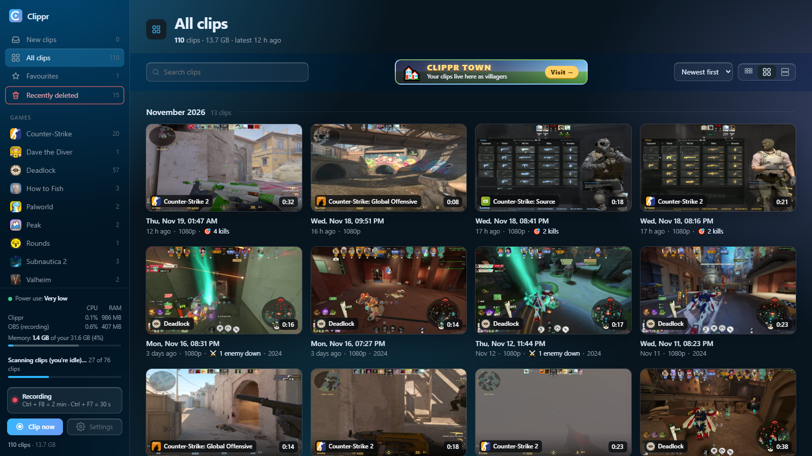
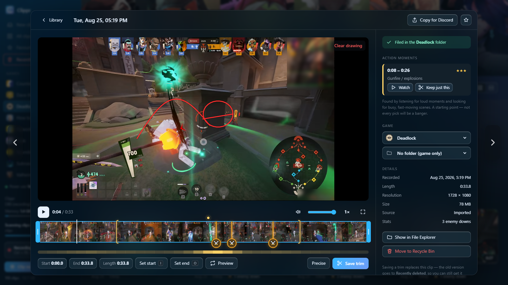
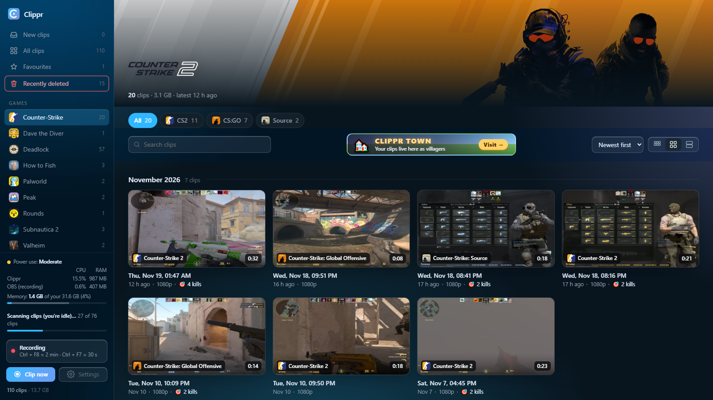
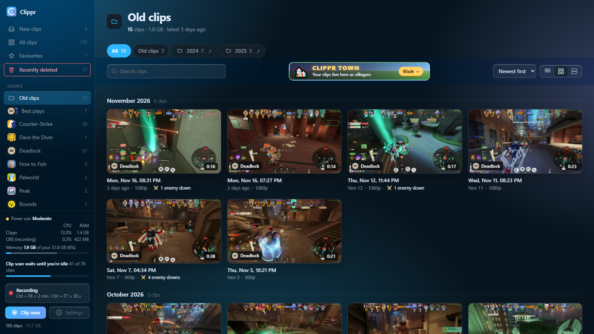

# 🎬 Clippr

**Your game clips, sorted, trimmed and shared — without a cloud account.**

Clippr records your games in the background with OBS. Press a key and the last 30 seconds (or 2 minutes) are saved as a clip, filed under the right game, with your kills already marked on the timeline.

### [⬇ Download ClipprSetup.exe](https://github.com/MyPantsRGone/Clippr/releases/latest)

Windows 10 / 11 · free · everything stays on your PC

---

## ✨ What it does

| | |
|---|---|
| 🎮 **Clip any game with one key** | Clippr keeps a replay buffer running in OBS (installed and set up for you). Press your clip key and the last moments are saved. Several keys can save different lengths, and whole game sessions can be recorded too. |
| 🗂 **Sorted automatically** | Every clip lands under the game you were playing, with the game's cover art. New clips wait in **New clips** until you've had a look. |
| 🎯 **Kills on the timeline** | Counter-Strike 2, Dota 2 and League report your kills, headshots and deaths officially. In Deadlock and Valorant, Clippr reads them from the clip itself. Every clip shows its best **action moments**. |
| ✂️ **Trim in a second** | Drag the handles and save — instantly and with no quality loss, or frame-exact. The old version goes to *Recently deleted*, so you can always get it back. |
| 💬 **Copy for Discord** | One click makes a copy that fits Discord's upload limit and puts it on your clipboard. Just press Ctrl+V in Discord. |
| 🏘 **Clippr Town** | Your clips live in a little pixel-art town as villagers, and the town grows as your library does. |
| 🎨 **Make it yours** | 16 themes, Liquid Glass, Frutiger Aero, animated backgrounds, or your own picture or video. |
| 🔄 **Updates itself** | Clippr checks this page for new versions and installs them when you say so. |

---

## 🎥 The clip editor

Watch, trim and file your clips. Kills and action moments are marked on the filmstrip. **Hold right-click on the video to draw** (the line fades after a few seconds), and use the arrows at the sides of the window, or **Shift + ← / →**, to go to the previous or next clip.

## 🕹 Game versions, together

Versions of the same game share one entry, with tabs at the top: **CS2, CS:GO and Source** under Counter-Strike, **Vanilla and Modded** under Minecraft, every GTA game (plus FiveM) under Grand Theft Auto, and so on. Covers download automatically, even for games you've uninstalled. If no cover can be found, the game's own icon is used.

## 📁 Folders inside folders

Drag a folder onto another folder and it becomes a tab there. That's handy for an *Old clips* folder holding *2024* and *2025*. Drag clips onto a tab to move them into it.

## 🏘 Clippr Town

Every clip is a villager. Clips with the most kills get the best houses, and each game gets its own building. Watch the town grow with **Town history**, or switch on **Adventure** for a walled city that defends itself from raiders.

## 🎨 Themes

---

## ⚡ Light on your PC

- **Nothing heavy while you play.** Clippr pauses its own work while a game is running.
- **Clip scanning only when you're away.** Reading kills from clips only runs while your PC is idle (no mouse or keyboard for 2 minutes). It stops the moment you're back, and you can pause or cancel it in **Settings → Clipping**.
- **Big libraries are fine.** Tested with 9,000 clips: the library loads as you scroll, and the town keeps 600 villagers out and about.

## 🔒 Private by design

- Clips, your library and your settings never leave your PC. There's no account and no upload.
- The only things Clippr downloads are OBS / FFmpeg (when installing), game covers (it sends only the game's name), and updates from this page.

## 📦 Install

1. Download **ClipprSetup.exe** from the [latest release](https://github.com/MyPantsRGone/Clippr/releases/latest).
2. Run it. It installs Clippr and anything that's missing (OBS, FFmpeg and Python).
3. A short setup asks for your clip key and where to keep clips. Then just play.

> Windows may warn about an unknown publisher the first time, because the installer isn't code-signed. Click **More info → Run anyway**.
